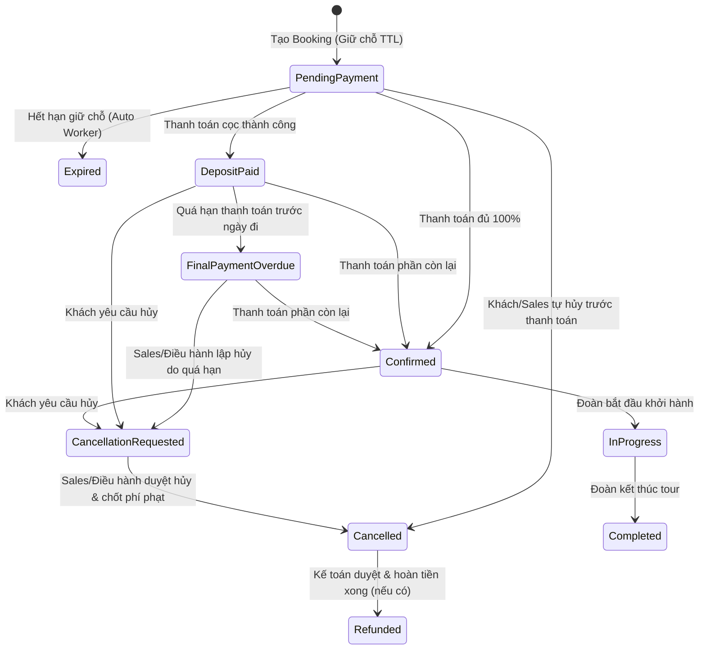

# 03. Nghiệp Vụ Đặt Tour, Giữ Chỗ (Seat Hold) & Quản Lý Hành Khách

## 1. Các kênh & quy trình Đặt Tour (Booking Flow)

Hệ thống hỗ trợ 2 kênh tạo booking nhưng dùng chung một lõi xử lý nghiệp vụ:
1. **Khách hàng tự đặt (B2C Online):** Chọn Tour $\rightarrow$ Chọn Ngày khởi hành $\rightarrow$ Chọn số lượng khách (Người lớn / Trẻ em / Em bé / Phòng đơn) $\rightarrow$ Nhập thông tin liên hệ & danh sách hành khách $\rightarrow$ Áp dụng mã khuyến mãi $\rightarrow$ Xác nhận giữ chỗ & Thanh toán QR.
2. **Nhân viên Sales tạo hộ (Internal Booking):** Khách liên hệ qua Hotline/Zalo/Tại quầy $\rightarrow$ Sales tạo booking trên Portal nội bộ, chọn nguồn khách (`Walk-in`, `Facebook`, `Zalo`, `Hotline`), gửi link thanh toán QR hoặc hướng dẫn đặt cọc cho khách.

---

## 2. Cơ chế Giữ chỗ tạm thời & Chống Overbooking (Seat Hold & Concurrency)

Đây là nghiệp vụ sống còn khi vận hành thực tế:

1. **Kiểm tra & Khóa đồng thời (Concurrency Control):**
   - Khi có yêu cầu đặt $N = \text{Adult} + \text{Child}$ chỗ (`SeatsRequired`), hệ thống thực hiện giao dịch nguyên tử (Database Transaction với Optimistic Concurrency `RowVersion` trên `TourDepartures`). `Infant` (em bé dưới 2 tuổi) không trừ vào `AvailableSlots` ghế chuẩn nhưng vẫn ghi nhận vào `Manifest` và kiểm soát giới hạn an toàn (`InfantCount <= AdultCount` hoặc cấu hình đoàn).
   - Điều kiện thành công: `AvailableSlots >= N`, `TourDeparture.Status == Open`, `Tour.Status == Published` (hoặc đặt nội bộ bởi `SALES` với tour `IsPublic = false`), và chưa quá `CutoffAt`.
2. **Giữ chỗ tạm (Hold Slot với TTL) & Hạn thanh toán phần còn lại:**
   - Ngay khi tạo Booking ở trạng thái `PendingPayment`:
     - `HeldSlots += N` (tương ứng `AvailableSlots = TotalCapacity - HeldSlots - BookedSlots` tự động giảm).
     - Gán `HoldExpiresAt = UtcNow + 15 phút` cho B2C (hoặc cấu hình linh hoạt cho `SALES`, VD: 120 phút khi khách chuyển khoản qua Zalo/tại quầy).
   - Khi khách chọn đặt cọc (`DepositPaid`), hệ thống ghi nhận `FinalPaymentDueAt = DepartureDate - X ngày` (mặc định 5 ngày trước khởi hành, lấy từ `SystemSettings`).
3. **Tự động nhả chỗ & Cảnh báo quá hạn phần còn lại (Background Worker):**
   - Job chạy định kỳ (30–60 giây) quét Booking `PendingPayment` có `HoldExpiresAt < UtcNow` $\rightarrow$ chuyển `Expired`, hoàn `HeldSlots -= N` (nếu đoàn đang `Full` sẽ tự mở lại `Open`) và hoàn lượt dùng khuyến mãi (`PromotionUsages`).
   - Job nhắc nợ hàng ngày: với Booking `DepositPaid` quá `FinalPaymentDueAt` mà chưa thanh toán đủ $\rightarrow$ chuyển sang trạng thái cảnh báo `FinalPaymentOverdue` và gửi thông báo cho `SALES` / `OPERATOR` / `ACCOUNTANT` xử lý liên hệ khách hoặc hủy đơn theo quy định (**không tự động hủy mất cọc của khách một cách âm thầm**).
   - Nếu khách thanh toán thành công từ `PendingPayment`: chuyển `HeldSlots -= N` sang `BookedSlots += N`, Booking sang `DepositPaid` hoặc `Confirmed`.

---

## 3. Quản lý Thông tin Hành khách (Passenger Manifest)

Mỗi Booking cần lưu thông tin người đại diện liên hệ (`ContactName`, `ContactPhone`, `ContactEmail`) và danh sách chi tiết từng hành khách (`BookingPassenger`):
- Họ và tên đầy đủ (in hoa không dấu nếu xuất vé máy bay).
- Giới tính, Ngày sinh (để kiểm tra đúng nhóm tuổi Adult/Child/Infant tại ngày khởi hành).
- Số CCCD / Hộ chiếu (Passport Number) & Ngày hết hạn hộ chiếu (bắt buộc với tour quốc tế).
- Quốc tịch.
- Yêu cầu đặc biệt: Ăn chay, dị ứng thực phẩm, tiền sử bệnh lý, xe lăn, đi cùng trẻ nhỏ, ghép phòng.
- Trạng thái bổ sung: Cho phép khách/Sales cập nhật thông tin hành khách trước ngày chốt đoàn (`CutoffDate`) nếu lúc đặt chưa có đủ CCCD của cả nhóm.

---

## 4. Nghiệp vụ Khuyến mãi & Mã giảm giá (Promotions & Vouchers)

- **Loại giảm giá:**
  - Giảm theo % (có giới hạn mức giảm tối đa, VD: 10% tối đa 500.000đ).
  - Giảm số tiền cố định (VD: 300.000đ/booking hoặc 100.000đ/khách).
- **Điều kiện áp dụng:**
  - Theo khoảng thời gian hiệu lực (`ValidFrom` – `ValidTo`).
  - Theo tổng giá trị đơn tối thiểu hoặc số khách tối thiểu (ưu đãi nhóm $\ge 4$ khách).
  - Áp dụng cho tất cả tour hoặc chỉ định danh sách Tour cụ thể.
  - Giới hạn tổng lượt sử dụng toàn hệ thống (`UsageLimit`) và giới hạn mỗi khách hàng (`MaxUsagePerUser`).
- **Quy tắc hoàn/hủy:** Khi booking bị hủy hoặc hết hạn giữ chỗ (`Expired`), lượt sử dụng mã giảm giá phải được hoàn trả lại quỹ mã (nếu chưa thanh toán).

---

## 5. Vòng đời Booking (Booking State Machine)

---

## 6. Nghiệp vụ Đổi Tour / Đổi Ngày, Thêm–Bớt Khách & Chuyển Nhượng

- **Đổi ngày khởi hành (Reschedule — bảng `BookingReschedules`):**
  - Khách muốn dời sang ngày khác của cùng Tour (hoặc sang Tour khác).
  - Hệ thống kiểm tra chính sách đổi (VD: trước 7 ngày được đổi 1 lần miễn phí hoặc thu phí đổi).
  - Xử lý nguyên tử: Giữ chỗ ở `Departure` mới $\rightarrow$ Nhả chỗ ở `Departure` cũ $\rightarrow$ Tính chênh lệch giá + phí đổi (nếu ngày mới giá cao hơn thì thu thêm; thấp hơn thì ghi nhận vào `CreditAmount` hoặc hoàn chênh lệch) $\rightarrow$ Lưu lịch sử vào `BookingReschedules`.
- **Điều chỉnh số lượng hành khách (trước `CutoffAt`):**
  - Cho phép `SALES`/`OPERATOR` thêm hoặc bớt khách trên Booking chưa khởi hành (`PendingPayment` / `DepositPaid` / `Confirmed`), cập nhật nguyên tử `BookedSlots` / `HeldSlots` trên `TourDeparture`, tính lại `TotalAmount` / `RemainingAmount` và ghi Audit Log.
- **Chuyển nhượng vé (Transfer Passenger):**
  - Cho phép đổi tên hành khách đi thay trước ngày chốt đoàn (nếu không dính vé máy bay định danh không hoàn đổi), có thể cấu hình thu phí hành chính hoặc miễn phí.
