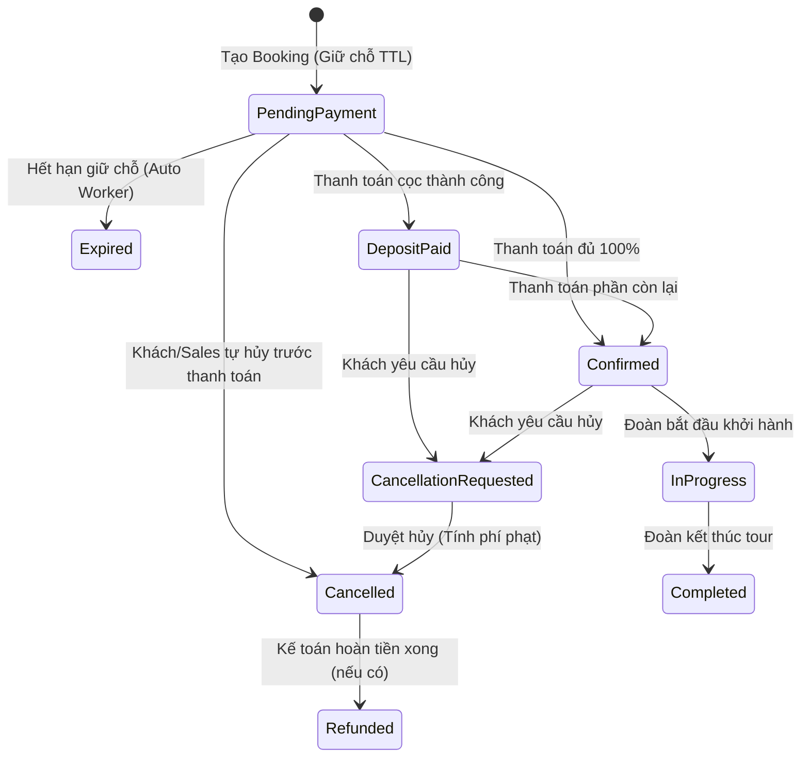

# 03. Nghiệp Vụ Đặt Tour, Giữ Chỗ (Seat Hold) & Quản Lý Hành Khách

## 1. Các kênh & quy trình Đặt Tour (Booking Flow)

Hệ thống hỗ trợ 2 kênh tạo booking nhưng dùng chung một lõi xử lý nghiệp vụ:
1. **Khách hàng tự đặt (B2C Online):** Chọn Tour $\rightarrow$ Chọn Ngày khởi hành $\rightarrow$ Chọn số lượng khách (Người lớn / Trẻ em / Em bé / Phòng đơn) $\rightarrow$ Nhập thông tin liên hệ & danh sách hành khách $\rightarrow$ Áp dụng mã khuyến mãi $\rightarrow$ Xác nhận giữ chỗ & Thanh toán QR.
2. **Nhân viên Sales tạo hộ (Internal Booking):** Khách liên hệ qua Hotline/Zalo/Tại quầy $\rightarrow$ Sales tạo booking trên Portal nội bộ, chọn nguồn khách (`Walk-in`, `Facebook`, `Zalo`, `Hotline`), gửi link thanh toán QR hoặc hướng dẫn đặt cọc cho khách.

---

## 2. Cơ chế Giữ chỗ tạm thời & Chống Overbooking (Seat Hold & Concurrency)

Đây là nghiệp vụ sống còn khi vận hành thực tế:

1. **Kiểm tra & Khóa đồng thời (Concurrency Control):**
   - Khi có yêu cầu đặt $N$ chỗ (`Adult + Child`, thường `Infant` không chiếm ghế xe/máy bay nhưng vẫn kiểm soát giới hạn an toàn nếu cần), hệ thống thực hiện giao dịch nguyên tử (Database Transaction với Optimistic Concurrency / RowVersion hoặc Pessimistic Lock / Distributed Lock theo `DepartureId`).
   - Điều kiện thành công: `AvailableSlots >= N` và Lịch khởi hành đang ở trạng thái `Open` và chưa quá `CutoffDate`.
2. **Giữ chỗ tạm (Hold Slot với TTL):**
   - Ngay khi tạo Booking ở trạng thái `PendingPayment`:
     - `HeldSlots += N`
     - `AvailableSlots -= N`
     - Gán `HoldExpiresAt = Now + 15 phút` (hoặc cấu hình linh hoạt cho Sales giữ chỗ lâu hơn, VD: 2 giờ cho khách đoàn/chuyển khoản).
3. **Tự động nhả chỗ khi hết hạn (Background Job / Worker):**
   - Một Background Service chạy định kỳ (VD: mỗi 30 giây – 1 phút) quét các Booking có `Status == PendingPayment` và `HoldExpiresAt < Now`.
   - Hệ thống tự động chuyển Booking sang `Expired`, đồng thời hoàn trả `HeldSlots -= N` và `AvailableSlots += N` (nếu đoàn đang `Full` sẽ tự mở lại `Open`).
   - Nếu khách thanh toán thành công trước khi hết hạn: chuyển `HeldSlots -= N` sang `BookedSlots += N`, Booking chuyển sang `DepositPaid` hoặc `Confirmed`.

---

## 3. Quản lý Thông tin Hành khách (Passenger Manifest)

Mỗi Booking cần lưu thông tin người đại diện liên hệ (`ContactName`, `ContactPhone`, `ContactEmail`) và danh sách chi tiết từng hành khách (`BookingPassenger`):
- Họ và tên đầy đủ (in hoa không dấu nếu xuất vé máy bay).
- Giới tính, Ngày sinh (để kiểm tra đúng nhóm tuổi Adult/Child/Infant tại ngày khởi hành).
- Số CCCD / Hộ chiếu (Passport Number) & Ngày hết hạn hộ chiếu (bắt buộc với tour quốc tế).
- Quốc tịch.
- Yêu cầu đặc biệt: Ăn chay, dị ứng thực phẩm, tiền sử bệnh lý, xe lăn, đi cùng trẻ nhỏ, ghép phòng.
- Trạng thái bổ sung: Cho phép khách/Sales cập nhật thông tin hành khách trước ngày chốt đoàn (`CutoffDate`) nếu lúc đặt chưa có đủ CCCD của cả nhóm.

---

## 4. Nghiệp vụ Khuyến mãi & Mã giảm giá (Promotions & Vouchers)

- **Loại giảm giá:**
  - Giảm theo % (có giới hạn mức giảm tối đa, VD: 10% tối đa 500.000đ).
  - Giảm số tiền cố định (VD: 300.000đ/booking hoặc 100.000đ/khách).
- **Điều kiện áp dụng:**
  - Theo khoảng thời gian hiệu lực (`ValidFrom` – `ValidTo`).
  - Theo tổng giá trị đơn tối thiểu hoặc số khách tối thiểu (ưu đãi nhóm $\ge 4$ khách).
  - Áp dụng cho tất cả tour hoặc chỉ định danh sách Tour cụ thể.
  - Giới hạn tổng lượt sử dụng toàn hệ thống (`UsageLimit`) và giới hạn mỗi khách hàng (`MaxUsagePerUser`).
- **Quy tắc hoàn/hủy:** Khi booking bị hủy hoặc hết hạn giữ chỗ (`Expired`), lượt sử dụng mã giảm giá phải được hoàn trả lại quỹ mã (nếu chưa thanh toán).

---

## 5. Vòng đời Booking (Booking State Machine)

---

## 6. Nghiệp vụ Đổi Tour / Đổi Ngày Khởi Hành & Chuyển Nhượng

- **Đổi ngày khởi hành (Reschedule):**
  - Khách muốn dời sang ngày khác của cùng Tour (hoặc sang Tour khác).
  - Hệ thống kiểm tra chính sách đổi (VD: trước 7 ngày được đổi 1 lần miễn phí hoặc thu phí đổi).
  - Xử lý nguyên tử: Giữ chỗ ở `Departure` mới $\rightarrow$ Nhả chỗ ở `Departure` cũ $\rightarrow$ Tính chênh lệch giá (nếu ngày mới giá cao hơn thì thu thêm; thấp hơn thì bảo lưu hoặc hoàn theo chính sách) $\rightarrow$ Ghi nhận lịch sử đổi.
- **Chuyển nhượng vé (Transfer Passenger):**
  - Cho phép đổi tên hành khách đi thay trước ngày chốt đoàn (nếu không dính vé máy bay định danh không hoàn đổi), có thể cấu hình thu phí hành chính hoặc miễn phí.
