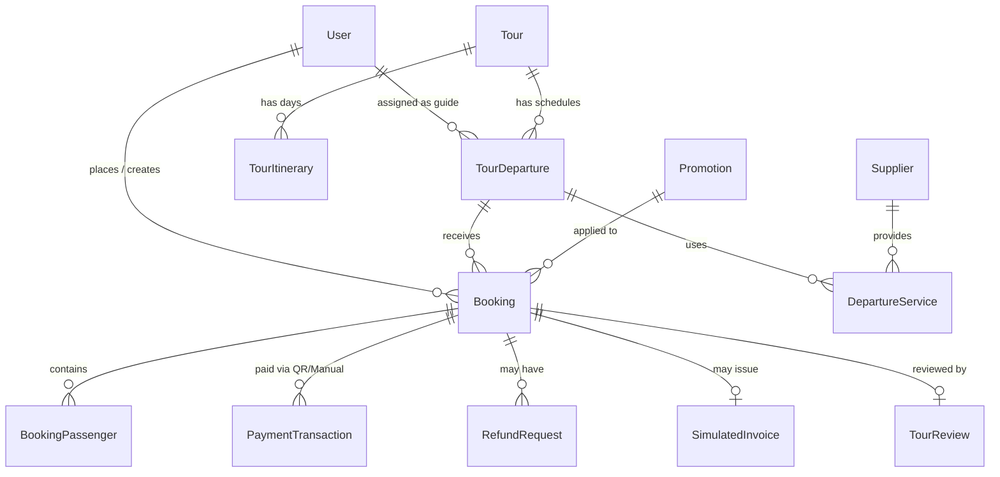

# 06. Thiết Kế Dữ Liệu Cốt Lõi (ERD), Nhóm API & Yêu Cầu Phi Chức Năng

## 1. Mô hình Thực thể Dữ liệu Cốt lõi (Core ERD)

### Mô tả ngắn các nhóm bảng chính:
- **Identity:** `Users`, `Roles`, `UserRoles`, `RefreshTokens`, `AuditLogs`.
- **Tour & Supply:** `Tours`, `TourItineraries`, `TourDepartures` (chứa `RowVersion` chống overbooking), `CancellationPolicies`, `Suppliers`, `DepartureServices`.
- **Booking:** `Bookings` (lưu `PriceSnapshot`, `TaxSnapshot`, `HoldExpiresAt`), `BookingPassengers` (lưu `CheckInStatus`), `Promotions`.
- **Finance (Actual + Simulated):** `PaymentTransactions` (chứa `QrPayload`, `IdempotencyKey`, `Status`), `RefundRequests`, `SimulatedInvoices` (lưu MST, số hóa đơn mô phỏng, `VatRate`, `VatAmount`).
- **Operations & CRM:** `DepartureChecklists`, `TourIncidents`, `TourReviews`.

---

## 2. Cấu trúc Nhóm API RESTful (ASP.NET Core 10 Web API)

Đề xuất chuẩn đường dẫn `/api/v1/...`:

| Nhóm API | Prefix | Các Endpoint tiêu biểu |
| :--- | :--- | :--- |
| **Auth & Users** | `/api/v1/auth`, `/api/v1/users` | `POST /login`, `POST /register`, `POST /refresh-token`, `GET /me`, `POST /staff` (Admin). |
| **Tours & Pricing** | `/api/v1/tours` | `GET /tours` (filter điểm đến, ngày, giá), `GET /tours/{slug}`, `POST /tours`, `PUT /tours/{id}`, `PUT /tours/{id}/publish`. |
| **Departures & Quota** | `/api/v1/departures` | `GET /tours/{id}/departures`, `POST /departures`, `PATCH /departures/{id}/status`, `GET /departures/{id}/manifest`. |
| **Suppliers** | `/api/v1/suppliers` | `GET /suppliers`, `POST /suppliers`, `POST /departures/{id}/services`. |
| **Bookings** | `/api/v1/bookings` | `POST /bookings` (giữ chỗ TTL), `GET /bookings/my`, `GET /bookings/{code}`, `PUT /bookings/{id}/passengers`, `POST /bookings/{id}/reschedule`, `POST /bookings/{id}/cancel-request`. |
| **Promotions** | `/api/v1/promotions` | `POST /promotions/validate`, `GET/POST/PUT /promotions`. |
| **Payment & QR Sim** | `/api/v1/payments` | `POST /payments/qr-create`, `GET /payments/{txCode}/status`, `POST /payments/qr-simulate-webhook` (Simulator), `POST /payments/manual-reconcile` (Kế toán). |
| **Refunds** | `/api/v1/refunds` | `GET /refunds`, `POST /refunds/{id}/approve`, `POST /refunds/{id}/complete`. |
| **Tax & Invoice Sim** | `/api/v1/invoices` | `POST /bookings/{id}/invoice-issue` (Mô phỏng), `GET /invoices/{id}`, `GET /invoices/{id}/preview`. |
| **Operations & Check-in** | `/api/v1/operations` | `POST /departures/{id}/assign-guide`, `PATCH /passengers/{id}/checkin`, `POST /departures/{id}/incidents`. |
| **Reviews & Reports** | `/api/v1/reviews`, `/api/v1/reports` | `POST /bookings/{id}/review`, `GET /reports/revenue`, `GET /reports/departure-profit`, `GET /reports/occupancy`. |

---

## 3. Yêu cầu Phi chức năng (Non-Functional Requirements)

1. **Tính toàn vẹn dữ liệu & Đồng thời (Concurrency & Consistency):**
   - Sử dụng `RowVersion` (Optimistic Concurrency) trên bảng `TourDepartures` để đảm bảo 2 khách đặt cùng 1 chỗ cuối cùng tại cùng một mili-giây sẽ chỉ có 1 người thành công, người còn lại nhận thông báo `409 Conflict` ("Số chỗ còn lại không đủ").
   - Xử lý Webhook thanh toán bắt buộc có **Idempotency** để tránh cộng tiền 2 lần.
2. **Tác vụ nền (Background Workers):**
   - Dùng `IHostedService` / `BackgroundService` (hoặc Hangfire/Quartz.NET) để:
     - Nhả chỗ các booking hết hạn giữ chỗ (`HoldExpiresAt < UtcNow`).
     - Nhắc lịch thanh toán phần còn lại trước ngày đi.
     - Tự động đánh dấu tour `InProgress` / `Completed` theo lịch (hoặc cảnh báo Điều hành).
3. **Chuẩn hóa phản hồi & Xử lý lỗi:**
   - Dùng chuẩn **RFC 7807 (`ProblemDetails`)** của ASP.NET Core cho tất cả lỗi (`400`, `401`, `403`, `404`, `409`, `500`).
   - Hỗ trợ phân trang (`PageIndex`, `PageSize`, `TotalCount`), lọc và sắp xếp chuẩn trên các API danh sách.
4. **OpenAPI & Tài liệu hóa:**
   - Tận dụng OpenAPI tích hợp sẵn của ASP.NET 10 (kèm Scalar hoặc Swagger UI ở môi trường Dev) để Frontend và QA test trực tiếp các API, bao gồm cả API mô phỏng quét mã QR.
