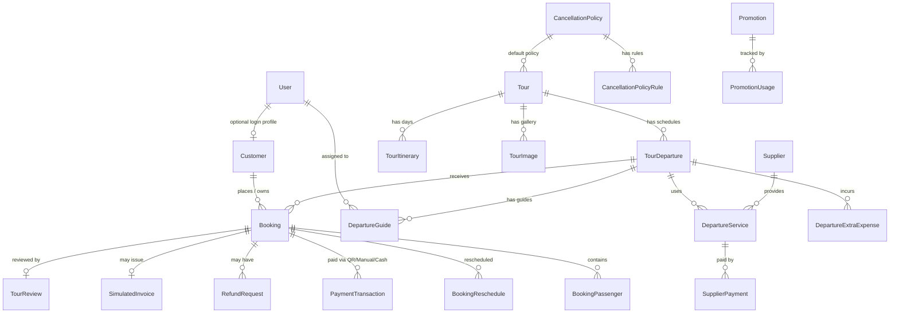

# 06. Thiết Kế Dữ Liệu Cốt Lõi (ERD), Nhóm API & Yêu Cầu Phi Chức Năng

> **Thiết kế vật lý chi tiết (SQL Server 2022):** Xem đầy đủ đặc tả 33 bảng, kiểu dữ liệu, ràng buộc `CHECK`/`UNIQUE`/Filtered Index và DDL tại [08-thiet-ke-csdl-sqlserver.md](./08-thiet-ke-csdl-sqlserver.md).

## 1. Mô hình Thực thể Dữ liệu Cốt lõi (Core ERD)

### Mô tả 7 nhóm bảng chính (33 bảng SQL Server 2022):
- **Identity & Config (7 bảng):** `Roles`, `Users`, `UserRoles`, `RefreshTokens`, `SystemSettings`, `CompanyBankAccounts`, `AuditLogs`.
- **CRM (1 bảng):** `Customers` (tách khỏi `Users` để hỗ trợ cả khách đặt online lẫn khách Walk-in/Zalo do `SALES` tạo hộ; theo dõi `TotalSpent`, `LoyaltyTier`).
- **Tour & Pricing (5 bảng):** `CancellationPolicies`, `CancellationPolicyRules`, `Tours` (`IsPublic`), `TourItineraries`, `TourImages`.
- **Departures & Supply (6 bảng):** `TourDepartures` (chứa `RowVersion` chống overbooking, computed `AvailableSlots`, `IsSettled`), `DepartureGuides` (nhiều HDV/đoàn), `DepartureChecklists`, `Suppliers`, `DepartureServices`, `DepartureExtraExpenses`.
- **Booking & Promotions (6 bảng):** `Promotions`, `PromotionTours`, `PromotionUsages`, `Bookings` (`RowVersion`, `PriceSnapshotJson`, `CancellationPolicySnapshotJson`, `HoldExpiresAt`, `FinalPaymentDueAt`), `BookingPassengers` (`CheckInStatus`), `BookingReschedules`.
- **Finance, Reconciliation & Cashbook (5 bảng):** `PaymentTransactions` (`RowVersion`, `ExpectedAmount`, `ActualReceivedAmount`, `ReconciliationStatus`, `IdempotencyKey`, unique `(BankCode, BankRef)`), `RefundRequests`, `SimulatedInvoices`, `SupplierPayments`, `FinancialLedgers` (sổ quỹ thu/chi hợp nhất).
- **Operations & Notifications (3 bảng):** `TourIncidents`, `TourReviews`, `Notifications`.

---

## 2. Cấu trúc Nhóm API RESTful (ASP.NET Core 10 Web API)

Đề xuất chuẩn đường dẫn `/api/v1/...`:

| Nhóm API | Prefix | Các Endpoint tiêu biểu |
| :--- | :--- | :--- |
| **Auth & Users** | `/api/v1/auth`, `/api/v1/users` | `POST /login`, `POST /register`, `POST /refresh-token`, `GET /me`, `POST /staff` (Admin). |
| **Settings & Banks** | `/api/v1/settings`, `/api/v1/bank-accounts` | `GET/PUT /settings`, `GET/POST/PUT /bank-accounts` (Admin). |
| **Customers (CRM)** | `/api/v1/customers` | `GET /customers`, `POST /customers`, `GET /customers/{id}/bookings`. |
| **Tours & Policies** | `/api/v1/tours`, `/api/v1/policies` | `GET /tours`, `GET /tours/{slug}`, `POST /tours`, `PUT /tours/{id}`, `PUT /tours/{id}/publish`, `GET/POST /policies`. |
| **Departures & Quota** | `/api/v1/departures` | `GET /tours/{id}/departures`, `POST /departures`, `PATCH /departures/{id}/status`, `POST /departures/{id}/settle`, `GET /departures/{id}/manifest`. |
| **Suppliers & AP** | `/api/v1/suppliers` | `GET /suppliers`, `POST /suppliers`, `POST /departures/{id}/services`, `POST /departure-services/{id}/payments`. |
| **Bookings** | `/api/v1/bookings` | `POST /bookings` (giữ chỗ TTL), `GET /bookings/my`, `GET /bookings/{code}`, `PUT /bookings/{id}/passengers`, `PATCH /bookings/{id}/adjust-pax`, `POST /bookings/{id}/reschedule`, `POST /bookings/{id}/cancel-request`, `POST /bookings/{id}/approve-cancel`. |
| **Promotions** | `/api/v1/promotions` | `POST /promotions/validate`, `GET/POST/PUT /promotions`. |
| **Payment & Reconciliation** | `/api/v1/payments` | `POST /payments/qr-create`, `POST /payments/manual-record`, `GET /payments/{txCode}/status`, `POST /payments/qr-simulate-webhook`, `POST /payments/{id}/reconcile` (Kế toán). |
| **Refunds & Ledger** | `/api/v1/refunds`, `/api/v1/ledger` | `GET /refunds`, `POST /refunds/{id}/approve`, `POST /refunds/{id}/complete`, `GET /ledger`. |
| **Tax & Invoice Sim** | `/api/v1/invoices` | `POST /bookings/{id}/invoice-issue` (Mô phỏng), `GET /invoices/{id}`, `GET /invoices/{id}/preview`. |
| **Operations & Check-in** | `/api/v1/operations` | `PUT /departures/{id}/guides`, `PATCH /passengers/{id}/checkin`, `POST /departures/{id}/incidents`, `POST /departures/{id}/extra-expenses`, `POST /extra-expenses/{id}/review`. |
| **Reviews & Reports** | `/api/v1/reviews`, `/api/v1/reports` | `POST /bookings/{id}/review`, `GET /reports/revenue`, `GET /reports/departure-profit`, `GET /reports/occupancy`. |

---

## 3. Yêu cầu Phi chức năng (Non-Functional Requirements)

1. **Tính toàn vẹn dữ liệu & Đồng thời (Concurrency & Consistency):**
   - Sử dụng `RowVersion` (Optimistic Concurrency) trên SQL Server 2022 cho các bảng `TourDepartures`, `Bookings`, `PaymentTransactions`, `Promotions` để đảm bảo 2 khách đặt cùng 1 chỗ cuối cùng tại cùng một mili-giây sẽ chỉ có 1 người thành công, người còn lại nhận `409 Conflict` ("Số chỗ còn lại không đủ").
   - Xử lý Webhook thanh toán bắt buộc có `IdempotencyKey` duy nhất và đối soát nội bộ có `UNIQUE (BankCode, BankRef)` (khi `BankRef IS NOT NULL`) để chống cộng tiền 2 lần.
2. **Tác vụ nền (Background Workers):**
   - Dùng `IHostedService` / `BackgroundService` để:
     - Nhả chỗ các booking hết hạn giữ chỗ (`HoldExpiresAt < SYSUTCDATETIME()`).
     - Nhắc lịch thanh toán phần còn lại trước ngày đi và chuyển trạng thái cảnh báo `FinalPaymentOverdue` khi quá `FinalPaymentDueAt`.
     - Tự động nhắc Điều hành / đánh dấu tour `InProgress` / `Completed` theo lịch.
3. **Chuẩn hóa phản hồi & Xử lý lỗi:**
   - Dùng chuẩn **RFC 7807 (`ProblemDetails`)** của ASP.NET Core cho tất cả lỗi (`400`, `401`, `403`, `404`, `409`, `500`).
   - Hỗ trợ phân trang (`PageIndex`, `PageSize`, `TotalCount`), lọc và sắp xếp chuẩn trên các API danh sách.
4. **OpenAPI & Tài liệu hóa:**
   - Tận dụng OpenAPI tích hợp sẵn của ASP.NET 10 (kèm Scalar hoặc Swagger UI ở môi trường Dev) để Frontend và QA test trực tiếp các API, bao gồm cả API mô phỏng quét mã QR.
